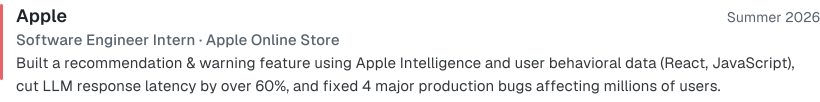
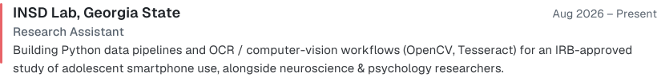
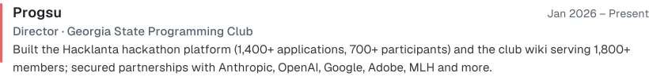
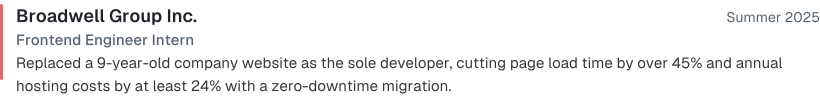
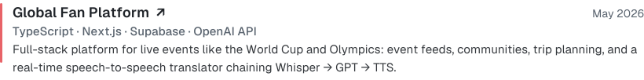
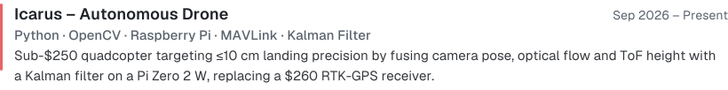
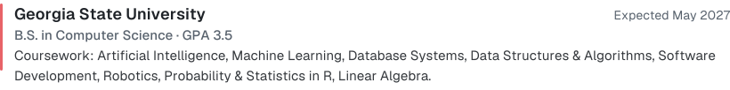

  <picture><source media="(prefers-color-scheme: dark)" srcset="assets/name-dark.svg" /></picture>
   
  <picture><source media="(prefers-color-scheme: dark)" srcset="assets/tagline-dark.svg" /></picture>

  <picture><source media="(prefers-color-scheme: dark)" srcset="assets/bits-dark.svg" /></picture>

 

<picture><source media="(prefers-color-scheme: dark)" srcset="assets/h-experience-dark.svg" /></picture>

<picture><source media="(prefers-color-scheme: dark)" srcset="assets/e-apple-dark.svg" /></picture>

<picture><source media="(prefers-color-scheme: dark)" srcset="assets/e-insd-dark.svg" /></picture>

<a href="https://wiki.progsu.com"><picture><source media="(prefers-color-scheme: dark)" srcset="assets/e-progsu-dark.svg" /></picture></a>

<picture><source media="(prefers-color-scheme: dark)" srcset="assets/e-bgi-dark.svg" /></picture>

 

<picture><source media="(prefers-color-scheme: dark)" srcset="assets/h-projects-dark.svg" /></picture>

<a href="https://github.com/Colby-Threlkeld/WC_App"><picture><source media="(prefers-color-scheme: dark)" srcset="assets/e-fan-platform-dark.svg" /></picture></a>

<picture><source media="(prefers-color-scheme: dark)" srcset="assets/e-icarus-dark.svg" /></picture>

<a href="https://github.com/Colby-Threlkeld/FuzzyRec"><picture><source media="(prefers-color-scheme: dark)" srcset="assets/e-fuzzyrec-dark.svg" /></picture></a>

 

<picture><source media="(prefers-color-scheme: dark)" srcset="assets/h-technical-skills-dark.svg" /></picture>

<picture><source media="(prefers-color-scheme: dark)" srcset="assets/s-languages-dark.svg" /></picture> 
<picture><source media="(prefers-color-scheme: dark)" srcset="assets/b-languages-dark.svg" /></picture>

<picture><source media="(prefers-color-scheme: dark)" srcset="assets/s-frontend-dark.svg" /></picture> 
<picture><source media="(prefers-color-scheme: dark)" srcset="assets/b-frontend-dark.svg" /></picture>

<picture><source media="(prefers-color-scheme: dark)" srcset="assets/s-backend-databases-apis-dark.svg" /></picture> 
<picture><source media="(prefers-color-scheme: dark)" srcset="assets/b-backend-dark.svg" /></picture>

<picture><source media="(prefers-color-scheme: dark)" srcset="assets/s-data-ml-devtools-dark.svg" /></picture> 
<picture><source media="(prefers-color-scheme: dark)" srcset="assets/b-data-ml-dark.svg" /></picture>

 

<picture><source media="(prefers-color-scheme: dark)" srcset="assets/h-education-dark.svg" /></picture>

<picture><source media="(prefers-color-scheme: dark)" srcset="assets/e-gsu-dark.svg" /></picture>

 

<picture><source media="(prefers-color-scheme: dark)" srcset="assets/h-contact-me-dark.svg" /></picture>

<a href="mailto:colby.threlkeld1@gmail.com"><picture><source media="(prefers-color-scheme: dark)" srcset="assets/t-email-dark.svg" /></picture></a> 
<a href="https://www.linkedin.com/in/colby-threlkeld-543b06301/"><picture><source media="(prefers-color-scheme: dark)" srcset="assets/t-linkedin-dark.svg" /></picture></a>

 

<picture><source media="(prefers-color-scheme: dark)" srcset="assets/h-github-stats-dark.svg" /></picture>

  <picture><source media="(prefers-color-scheme: dark)" srcset="https://streak-stats.demolab.com?user=Colby-Threlkeld&hide_border=true&theme=dark&background=0D1117" /></picture>

